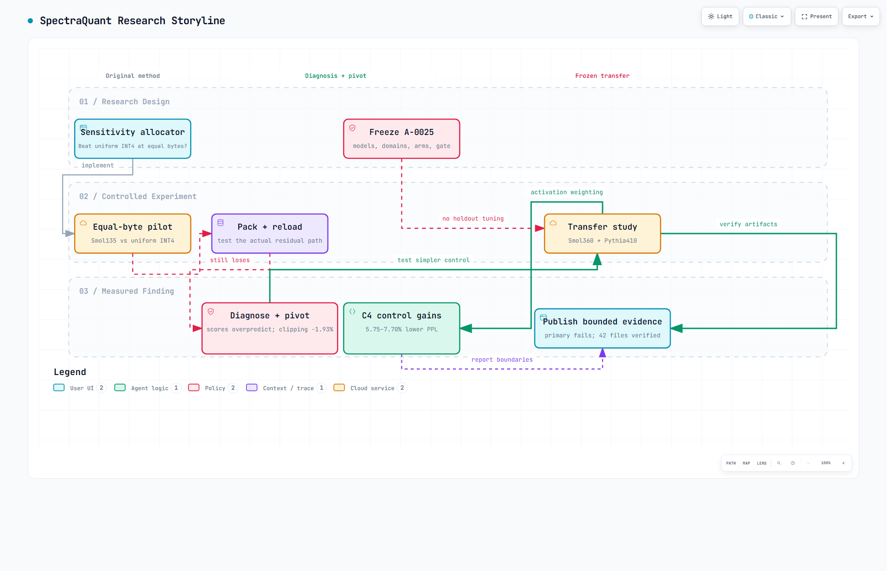
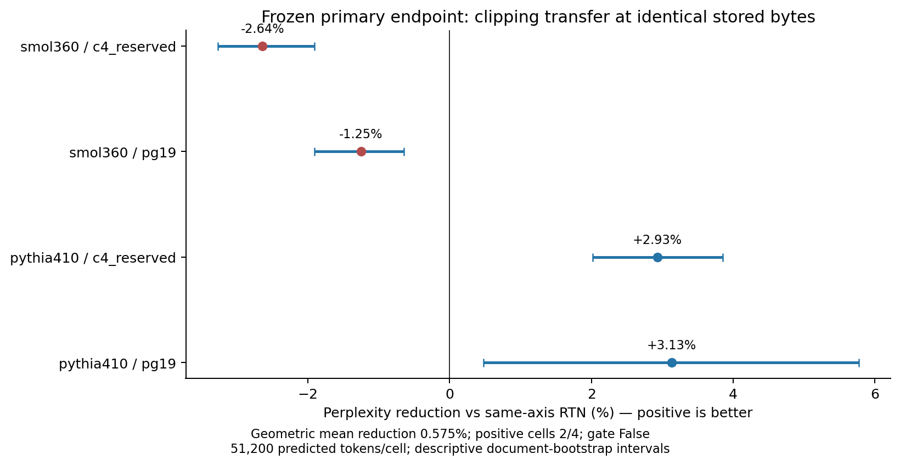
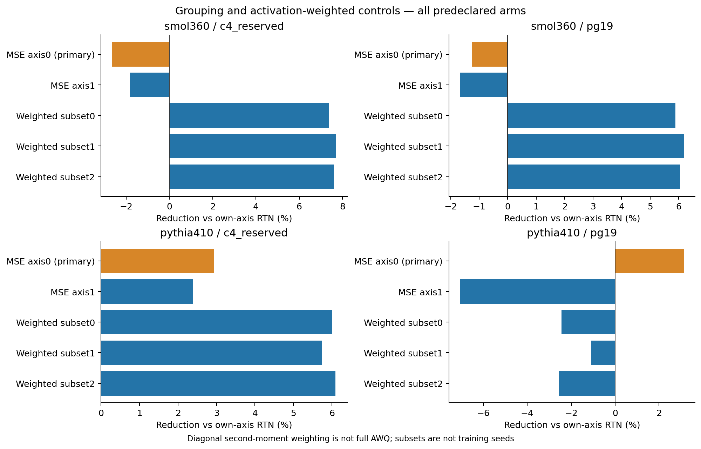
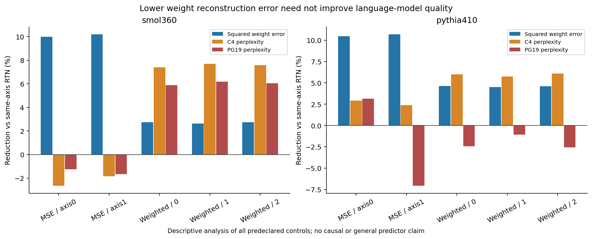
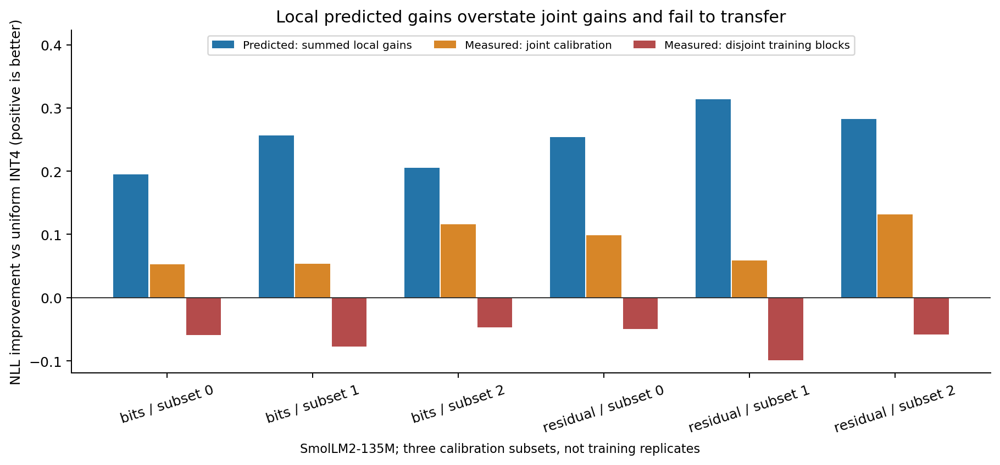
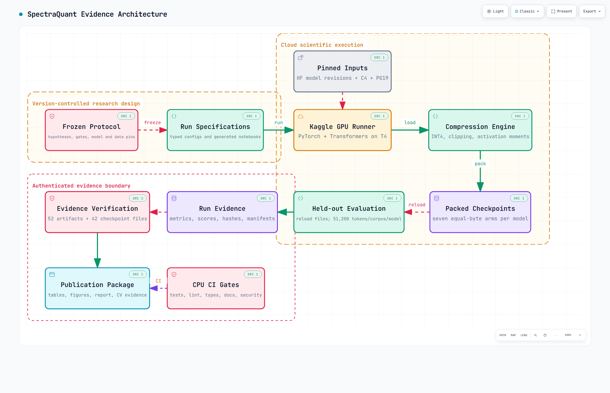

# SpectraQuant

**A reproducible transformer-compression study about when local quantization objectives do—and do not—preserve whole-model language quality.**

[](https://github.com/OussemaHarrabi/SpectraQuant/actions/workflows/ci.yml)
[](https://github.com/OussemaHarrabi/SpectraQuant/actions/workflows/docs.yml)
[](https://github.com/OussemaHarrabi/SpectraQuant/actions/workflows/security.yml)
[](pyproject.toml)
[](src/spectraquant)
[](docs/report/spectraquant-research-synthesis.md)

SpectraQuant started with an ambitious hypothesis: a sensitivity-aware mixture of low ranks and low bit widths should beat uniform INT4 quantization at the same stored-memory budget. The method did **not** win. Instead of hiding that result, the project traced the failure from the allocation surrogate to the deployed packed operator, tested a simpler clipping control, then froze a two-model/two-domain transfer study before reading its holdouts.

The result is a complete research story: a negative method result, a measured diagnosis, a principled pivot, useful bounded improvements, and explicit evidence showing where those improvements stop transferring.

- **Research synthesis:** [the complete reader-oriented account](docs/report/spectraquant-research-synthesis.md)
- **Paper:** [LaTeX source](reports/paper/spectraquant-research-paper.tex) · [compiled PDF](output/pdf/SpectraQuant_Research_Report_2026.pdf)
- **Final transfer results:** [Phase 4 tables and protocol](docs/results/phase4-clipping-transfer.md)
- **Reproducibility:** [commands, provenance and evidence boundaries](reports/REPRODUCIBILITY.md)
- **Interactive visuals:** [evidence architecture](docs/diagrams/spectraquant-system.html) · [research storyline](docs/diagrams/spectraquant-study.html)

> **Headline result.** Predeclared activation-weighted INT4 controls reduced C4 perplexity by **7.39–7.70% on SmolLM2-360M** and **5.75–6.09% on Pythia-410M** against matched group32/axis1 RTN at identical checkpoint bytes. The same control regressed on Pythia PG19, so this is a bounded calibration-domain result, not a universal improvement.



## Research question

The project asks:

> Can inexpensive local compression scores choose a low-bit representation that preserves end-to-end language-model quality under a measured, equal-byte checkpoint budget?

That question is evaluated with three rules:

1. **Compare quality only at equal measured bytes.**
2. **Evaluate the representation that is actually serialized and reloaded.**
3. **Freeze model, data, arms and gates before reading fresh holdouts.**

The original method combines low-rank residuals, low-bit quantization, layer-level sensitivity proxies and constrained allocation. When it failed, later phases simplified one assumption at a time rather than searching indefinitely for a positive number.

## The study as one storyline

| Stage | Question | Result | Decision |
|---|---|---|---|
| Original pilot | Can the trained allocator beat uniform INT4 at equal target bytes? | **No.** Perplexity 23.1698 without the regularizer and 23.3131 with it, versus 18.6193 for uniform INT4. | Reject the original improvement claim. |
| Partial LR-QAT reproduction | Does the expected QAT direction appear under the resource cap? | PPL 26.9432 → 24.1265; **21.8%** of the FP16-gap closure, below the frozen 25% gate. | Record partial direction, not confirmation. |
| Phase 2: deployment correction | Does evaluating packed/reloaded `Q(W)+Q(B)Q(A)` rescue allocation? | **No.** Validation retained uniform INT4; six alternatives worsened test PPL by **5.52–14.75%**. | Diagnose the score rather than tune the holdout. |
| Phase 3: joint-loss diagnosis | Do summed marginal gains predict the joint model? | **No.** Every candidate overpredicted joint calibration gain and worsened disjoint-block loss. | Pivot to a simpler conventional control. |
| Phase 3: clipping pilot | Can weight-only clipping improve a fresh C4 holdout at identical bytes? | **Yes, once.** PPL 28.0056 → 27.4656, a **1.9279%** reduction. | Freeze a transfer study before more holdout access. |
| Phase 4: transfer | Does fixed MSE clipping transfer across two architectures and two corpora? | **Mixed.** 2/4 cells improved; geometric-mean gain **0.5752%**, but the frozen 3/4 consistency gate failed. | Reject consistent transfer. |
| Phase 4: secondary control | Does activation weighting help under matched axis1 grouping? | C4 improved on both models; Smol PG19 improved; Pythia PG19 regressed. | Publish a bounded positive result and the failure boundary. |

Earlier phases use different token/context protocols, so their raw perplexities are not a chronological learning curve. Each number is interpreted only inside its own matched comparison.

## Final transfer results

### Primary: fixed weight-MSE clipping versus RTN

All four comparisons use group32/axis0 INT4, reloaded packed files and exactly matched model-specific storage. Positive reduction means lower perplexity.

| Model | Reserved corpus | RTN PPL | MSE-clipped PPL | PPL reduction |
|---|---|---:|---:|---:|
| SmolLM2-360M | C4 | 21.8140 | 22.3901 | **−2.6408%** |
| SmolLM2-360M | PG19 | 16.6734 | 16.8819 | **−1.2501%** |
| Pythia-410M | C4 | 32.3251 | 31.3777 | **+2.9311%** |
| Pythia-410M | PG19 | 27.9244 | 27.0500 | **+3.1313%** |

The geometric mean reduction is **0.5752%**, above the predeclared 0.5% magnitude threshold. Only **2/4** cells improve, below the required **3/4**, so the primary hypothesis fails.



### Secondary: activation-weighted clipping

The three rows represented by each range vary calibration subsets, not training seeds. Each comparison uses its own group32/axis1 RTN baseline.

| Model | Reserved corpus | PPL reduction range | Full checkpoint bytes |
|---|---|---:|---:|
| SmolLM2-360M | C4 | **+7.3882 to +7.7028%** | 271,561,031 |
| SmolLM2-360M | PG19 | **+5.8906 to +6.1849%** | 271,561,031 |
| Pythia-410M | C4 | **+5.7462 to +6.0939%** | 302,615,137 |
| Pythia-410M | PG19 | **−2.5608 to −1.0864%** | 302,615,137 |

This control is stable on reserved C4 prefixes across both architectures and all three calibration subsets. Its regression on Pythia PG19 shows domain sensitivity. The project therefore claims a measured C4 improvement, not broad robustness.



### A useful negative result: reconstruction error is not language quality

Weight-MSE clipping lowered aggregate weight squared error by roughly **10%** in several cells while making perplexity worse. On Pythia axis1, 10.69% lower weight error coincided with 7.06% worse PG19 perplexity. This is the central engineering lesson: a better local reconstruction objective does not guarantee a better autoregressive model.



The same mismatch appeared earlier. Marginal layer gains looked promising in isolation, then failed when all selected changes were composed in one model.



## Frozen Phase 4 protocol

- **Models:** SmolLM2-360M and Pythia-410M at immutable model revisions.
- **Corpora:** reserved C4 validation documents and PG19 test-book prefixes.
- **Evaluation:** 51,200 predicted tokens per corpus/model; document boundaries preserved.
- **Arms:** seven symmetric INT4/group32 checkpoints per model: RTN and MSE on axis0/axis1, plus activation-weighted axis1 using three calibration subsets.
- **Selection discipline:** all arms and gates frozen before holdout loading; no tuning on exposed Phase 4 holdouts.
- **Storage parity:** every model’s seven arms have identical target-payload and full-checkpoint bytes.
- **Evidence:** 52 expected artifacts and 42 checkpoint files passed provenance, checksum and protocol validation.
- **Compute:** two first-submission Kaggle runs, approximately 1.511 visible T4 device-hours combined. This is runtime telemetry, not exact account billing.



## What the numbers mean

SpectraQuant keeps quality, storage and execution claims separate:

| Class | What is measured here | What it supports |
|---|---|---|
| **Class 1** | Analytical payload accounting | Budget design and cross-checks |
| **Class 2** | Dense FP16 execution of reconstructed quantized weights | Perplexity and loss comparisons |
| **Class 3** | Serialized target/layout/unchanged-weight files | Actual checkpoint byte claims |
| **Class 4-CPU** | A repository-produced ONNX low-bit container on a real CPU kernel | A bounded local kernel-path check |

The transfer study does **not** claim GPU low-bit acceleration, service latency, independent training replication, state-of-the-art quality or publication acceptance.

Model-specific Phase 4 storage is exact across all seven arms:

| Model | Target payload | Full checkpoint |
|---|---:|---:|
| SmolLM2-360M | 176,947,200 B | 271,561,031 B |
| Pythia-410M | 198,844,416 B | 302,615,137 B |

## System architecture

The repository separates scientific design, cloud execution and authenticated evidence:

- `docs/research/` and `docs/decisions/` freeze questions, gates and amendments.
- `configs/` and `notebooks/final/` turn that design into typed run specifications and generated notebooks.
- `src/spectraquant/` implements factorization, quantization, allocation, evaluation and provenance.
- `artifacts/sample-results/` stores bounded, reviewable evidence rather than mutable run directories.
- `scripts/reproduce/` regenerates tables and figures from committed artifacts.
- `reports/`, `docs/results/` and `CAREER_EVIDENCE.md` publish claims with their limits.

Open the [interactive architecture](docs/diagrams/spectraquant-system.html) to inspect nodes and source references.

## Reproduce and inspect

The local workflow uses Python 3.11 and [uv](https://docs.astral.sh/uv/):

```bash
uv sync --all-extras
uv run spectraquant --help
uv run spectraquant smoke --config configs/experiment/smoke.yaml
uv run pytest -q
make check
```

Regenerate the study tables and figures from committed evidence:

```bash
uv run python scripts/reproduce/generate_release_artifacts.py
uv run python scripts/reproduce/research_figures.py
```

Research-scale model execution is cloud-only. The repository’s `cloud` adapter generates and collects typed Kaggle/Colab notebooks; collection validates provenance and never silently resubmits compute. See [the full reproducibility record](reports/REPRODUCIBILITY.md) before launching a new study.

Build the publication PDF locally:

```bash
uv run scripts/reproduce/build_research_report.py
```

## Repository map

```text
src/spectraquant/
  allocation/       uniform, greedy and exact constrained allocation
  benchmarking/     byte accounting and bounded kernel checks
  cloud/            typed cloud plans, notebook generation and collection
  evaluation/       quality evaluation and deterministic fixtures
  factorization/    SVD and low-rank residual machinery
  proxies/          sensitivity and error proxies
  quantization/     fake quantization, packing, reload and accounting
  regularizers/     rounding-aware preparation objectives
  reporting/        manifests, comparability and provenance
  training/         deterministic preparation/training loops
configs/            Hydra experiment, reproduction and cloud plans
artifacts/          schemas and committed evidence packages
docs/               protocols, ADRs, results, synthesis and diagrams
notebooks/final/    generated cloud notebooks and frozen inputs
reports/            paper, reproducibility record, tables and figures
scripts/            experiment, cloud, data and reproduction entry points
tests/              unit, integration and regression checks
```

## Research conclusions

1. The original sensitivity allocator does not beat uniform INT4 in the tested equal-byte setting.
2. Matching evaluation to the packed/reloaded operator does not rescue that allocator.
3. Summed local improvements can overpredict the behavior of a jointly modified transformer.
4. Fixed clipping can improve quality, but its transfer depends on architecture, corpus and grouping.
5. Activation-weighted clipping is a strong C4 control in this study, with a documented PG19 failure.
6. Exact storage, frozen holdouts and artifact authentication make negative results usable rather than disposable.

Future work should begin with a new protocol and untouched data. The strongest next scientific tests are independent training replications, stronger modern PTQ baselines, covariance-aware objectives and real GPU low-bit kernels.

## License

See [LICENSE](LICENSE).
