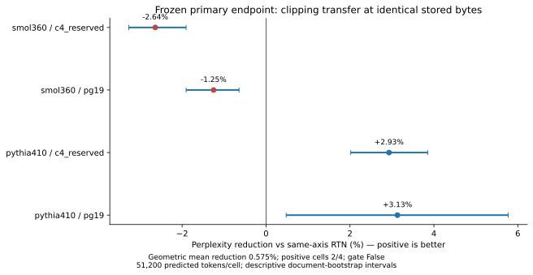
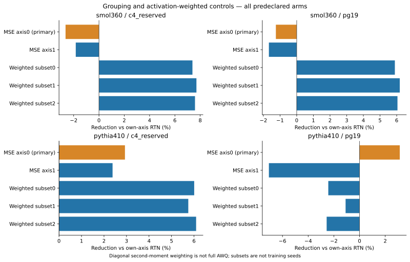
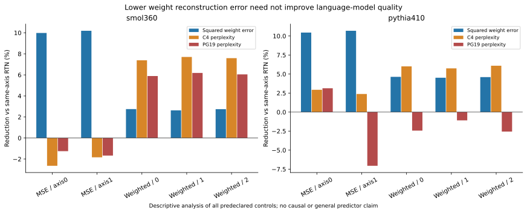

# SpectraQuant: from local compression scores to whole-model quality

12 October 2026. Completed bounded research study, with the original larger
training and reproduction programme still open. This report is a public technical
report, not a peer-reviewed publication or a state-of-the-art claim.

## The question and the coherent progression

Can cheap local compression decisions preserve language-model quality at a
measured checkpoint budget? SpectraQuant began with low-rank/low-bit allocation.
Its negative results motivated a deployment correction, a joint-loss diagnosis,
and then progressively simpler controls. The final transfer study tests the
same question across model architecture and text domain; it does not replace
the failed original method with an unrelated success story.

| Stage | Question | Measured answer |
|---|---|---|
| Original training pilot | Does allocated factor training beat uniform INT4 at matched target bytes? | No: SmolLM2-135M perplexity 23.1698 without the regularizer versus 18.6193 for INT4; the regularizer also worsens quality. |
| Deployment correction, A-0023 | Does scoring the actual packed/reloaded residual operator rescue allocation? | No: validation retains INT4; six alternatives worsen the previously exposed WikiText test by 5.52–14.75%. |
| Diagnosis, A-0024 | Do summed local gains predict joint loss and transfer? | They overstate joint calibration gains; all six allocations worsen loss on disjoint training blocks. |
| Simpler control, A-0024 | Can conventional clipping improve a fresh holdout at identical bytes? | Yes in one pilot: Smol135 C4 perplexity 28.0056 to 27.4656, a 1.93% reduction. |
| Transfer, A-0025 | Does that fixed weight-only criterion transfer in four prescribed cells? | Mixed: Pythia improves, Smol360 regresses. Two positive cells fail the frozen three-cell requirement. |
| Predeclared secondary controls, A-0025 | How sensitive are outcomes to grouping and activation weighting? | Activation weighting helps C4 on both architectures, but regresses Pythia PG19; grouping orientation can produce a much larger difference. |

The earlier studies use different token/context protocols. Their raw perplexities
must not be compared as a time-series improvement. Sources are the
[original pilot](../results/tier1-method-comparison.md),
[Phase2](../results/phase2-global-damage.md),
[Phase3](../results/phase3-controlled-followup.md), and
[complete Phase4 tables](../results/phase4-clipping-transfer.md).

## Frozen transfer design

[ADR-0025](../decisions/ADR-0025-phase4-clipping-transfer.md) and amendment A-0025
freeze the design before either run. Scientific source:
`71a1ec11cea6be90a6ab49356e81d980f4667784`, clean in both executions.

- SmolLM2-360M and Pythia-410M, immutable model revisions; actual loaded named
  parameter counts 361,821,120 and 405,334,016 respectively.
- Reserved C4 validation rows 320:640 and the first 50 PG19 test books as source
  pools. The first 200 C4 training documents supply calibration only.
- Seven symmetric INT4/group32 checkpoints per model: RTN/MSE axis0, RTN/MSE
  axis1, and diagonal-activation-weighted MSE axis1 from calibration subsets 0/1/2.
- Fixed clipping grid 1, .95, .9, .85, .8, .75. No NLL search or gradient training.
- All seven checkpoints are written and frozen before holdout loading; evaluation
  reloads the packed files. Model-specific target and full-checkpoint sizes match
  exactly across all seven arms.
- Exactly 51,200 predicted tokens per corpus/model, sequence 1024 and at most 2,048
  input tokens per document, with preserved boundaries. C4 uses 105/108 evaluated
  documents for Smol/Pythia; PG19 uses 26 each. Tokenizers differ, so comparisons
  are paired within each model, not raw perplexity averages between models.
- Three subsets vary calibration, not model training or independent replication.
  Document-cluster bootstrap intervals are descriptive corpus uncertainty.

Axis0 groups output rows for a fixed input feature. A diagonal input second
moment multiplies that group's objective by a constant and cannot change its
minimizer. Activation weighting is therefore tested on axis1 against its own
RTN and MSE controls. This avoids attributing a grouping change to weighting.

The core weighting proxy is proportional to
`sum_j E[x_j²] * sum_i (W_ij - Q(W)_ij)²`. It omits feature covariance and is
not measured output error. This is a conventional criterion, not full AWQ.

## Primary result: the consistency gate fails

Positive reduction means lower perplexity. All comparisons below are MSE
clipping against RTN with the same group32/axis0 layout and identical bytes.

| Model | Corpus | RTN PPL | MSE-clipped PPL | Reduction |
|---|---|---:|---:|---:|
| Smol360 | C4 reserved | 21.8140 | 22.3901 | -2.6408% |
| Smol360 | PG19 prefixes | 16.6734 | 16.8819 | -1.2501% |
| Pythia410 | C4 reserved | 32.3251 | 31.3777 | +2.9311% |
| Pythia410 | PG19 prefixes | 27.9244 | 27.0500 | +3.1313% |

The within-cell log-ratio geometric mean reduction is **0.5752%**, exceeding the
predeclared 0.5% magnitude threshold. However, only **2/4 cells** improve, below
the required 3/4. The primary transfer test therefore **fails**. A positive mean
does not establish consistent transfer, and secondary outcomes do not rescue it.

## Secondary results: useful gains with visible boundaries

The following ranges include all three activation-calibration subsets; they are
not the best selected seed. Baseline is each model's own axis1 RTN.

| Model | Corpus | Activation-weighted PPL reduction range | Full checkpoint B |
|---|---|---:|---:|
| Smol360 | C4 reserved | +7.3882 to +7.7028% | 271,561,031 |
| Smol360 | PG19 prefixes | +5.8906 to +6.1849% | 271,561,031 |
| Pythia410 | C4 reserved | +5.7462 to +6.0939% | 302,615,137 |
| Pythia410 | PG19 prefixes | -2.5608 to -1.0864% | 302,615,137 |

Thus the activation-weighted controls improve C4 on both architectures at no
additional stored bytes, with similar outcomes across the three subsets.
Their failure on Pythia's book prefixes prevents a universal or domain-robust
claim. Calibration-domain sensitivity is a plausible explanation, not a uniquely
established cause; this study does not measure new book-domain calibration.

Grouping is also consequential. On Pythia PG19, RTN axis1 scores 20.1353 versus
27.9244 for RTN axis0, a **27.8936%** reduction at identical target and full bytes.
That is a predeclared grouping comparison, not an activation-weighting gain.
On Smol360 C4, axis1 instead worsens RTN perplexity by 3.8878%. Grouping is not
universally preferable in one direction.

## What the diagnostics establish

Smol360 weight-only MSE clipping reduces aggregate weight squared error by
9.9839% on axis0 and 10.1919% on axis1, yet worsens perplexity on both domains.
Lower weight reconstruction error therefore **did not ensure** better language
quality in these comparisons. Pythia axis1 gives another counterexample:
10.69% lower weight error accompanies 7.06% worse PG19 perplexity.

Activation weighting reduces the diagonal proxy more than unweighted clipping,
while its language-quality outcome still depends on the cell. Proxy agreement
on C4 does not establish a general predictor or isolate a causal mechanism.
The source scores authenticate to each remote manifest before their figures
or extracted attestations are accepted. Complete derived values and the formula
are in the [diagnostic table](../../reports/tables/clipping-proxy-diagnostics.md).

## Measurement, compute and reproducibility

Quality is **class 2**, dense FP16 execution of reconstructed packed weights.
Storage is **class 3**, measured target/layout/unique-unchanged-weight files;
tokenizer and runtime are excluded. Smol payload 176,947,200 B/full 271,561,031 B;
Pythia payload 198,844,416 B/full 302,615,137 B. There is no GPU low-bit kernel,
speedup, service latency or downstream-accuracy claim.

Two private free Kaggle runs completed on their first submission, with sequential
GPU execution and local downloads overlapping the second run. All **52 expected
artifacts and 42 checkpoint files** pass collection, checksum, protocol and
cross-model source/corpus-fingerprint checks. Original metrics, scores and frozen
descriptors are copied unchanged into
`artifacts/sample-results/phase4-transfer/`. `collection.json` files are extracted
attestations, not original manifests or independent scientific reruns.

Cloud intervals through runner finish are 1,126.932 s and 1,593.199 s on two visible
T4s: approximately **1.511184 visible-device-hours** combined. They include
installation but exclude final export/platform overhead and are not exact
account quota billing. The prelaunch maximum was 6 h. No additional experiment,
retry, paid compute or local real-model execution was used. The optional kernel
study is deferred because its required primary transfer gate did not pass.

Scientific execution uses Python 3.11.16/Torch 2.11.0+cu128. Kaggle's notebook
bootstrap Python 3.13 is a separate process. The RunSpec explicitly replaces the
CPU Torch 2.14.1 lock entry with the declared CUDA Torch 2.11.0 build; this is a
documented environment override, not an unchanged CPU lock installation.
Actual versions, source hashes and intervals are preserved in the attestations
and private installation/execution logs.

The [generated input notebooks](../../notebooks/final/README.md) preserve the
original source/spec. Collection does not submit compute. Numerical summaries
are recreated by `phase4_resume.py --aggregate`; scientific figures and the
diagnostic table by `scripts/reproduce/research_figures.py`, with input/output
hashes recorded. New scientific execution needs new run IDs and budget.

## What this adds to a research CV

Evidence supports experimental design, literature-driven partial reproduction,
PyTorch/Hugging Face implementation, constrained allocation, exact storage
accounting, calibration controls, cloud execution, artifact authentication and
quantified negative-result analysis. A bounded positive statement is:

> Built a reproducible transformer-compression benchmark across two architectures;
> predeclared activation-weighted INT4 controls reduced C4 perplexity 5.75–7.70%
> versus matched group32/axis1 RTN on reserved C4 prefixes at identical checkpoint
> bytes, while documenting model/domain transfer failures.

This is a conventional-control result, not a novel SpectraQuant allocator gain.
Original Tier2, full LR-QAT/LoftQ reproduction, required independent training
seeds, stronger modern PTQ comparisons and real GPU low-bit execution remain open.
This completes the bounded study and report package; further research should
start from a new question/protocol/holdout rather than retuning these exposed cells.
